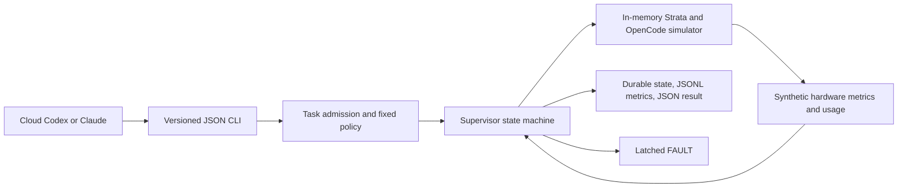

# On-demand Windows AI worker supervisor — phase 1

**Status: architecture and simulation only. Live execution is unavailable.**

This adds a separate TypeScript CLI to Local Copilot. It exercises one small coding task with synthetic Strata/OpenCode lifecycles and telemetry. It never opens the model endpoint, starts a child process, queries hardware, loads a model, edits a source file, applies a patch, or changes existing settings. Normal CPU and disk activity comes from the simulator, compiler, and tests.

The target supplied by the owner is Windows, an RTX 3080 Ti laptop GPU with 16 GB VRAM, 32 GB RAM, Strata in `D:\AI`, launcher `run-coder-iq1_m.bat`, Qwen3.8 Flash Next Coder IQ1_M, and an OpenAI-compatible endpoint at `http://localhost:8080/v1`. OpenCode and a Codex CLI custom profile reportedly work with it. These are recorded inputs, not discoveries or validations performed in this phase.

The previous sustained workload ended in an unexplained instant shutdown with Kernel-Power 41 and bugcheck 0. That event is not a diagnosis: Microsoft's guidance says Event 41 may lack enough information to determine the cause, and abrupt failures can prevent error recording. This implementation does not conclude that overheating, power delivery, or any particular component caused the shutdown. [Microsoft Event 41 guidance](https://learn.microsoft.com/en-us/troubleshoot/windows-client/performance/event-id-41-restart).

The referenced conversation exposed assistant-message placeholders, not the full latest implementation brief. This phase therefore uses the owner's explicit handoff requirements. The assumptions and deferred work below remain visible for review.

## Run the simulator

From the Local Copilot repository, with its existing dependencies installed:

```powershell
npm run build
node dist/src/supervisor-cli.js plan --task examples/supervisor/task.json
node dist/src/supervisor-cli.js simulate --task examples/supervisor/task.json
node dist/src/supervisor-cli.js status
node dist/src/supervisor-cli.js scenarios
```

`plan` only reads the supplied JSON task; it creates no state. `simulate` advances virtual time immediately. The default output/state directory is `.runtime/supervisor-sim`, which is already ignored by the project's existing ignore rules. It is separate from the previous local model setup. An explicit `--state-dir` selects an isolated **simulation** domain; using a new directory is not an acceptable live fault-recovery mechanism.

Inject a safety event and verify the latch across separate invocations:

```powershell
node dist/src/supervisor-cli.js simulate --task examples/supervisor/task.json --scenario gpu-hot
node dist/src/supervisor-cli.js status
node dist/src/supervisor-cli.js simulate --task examples/supervisor/task.json
```

The first command faults. The third is rejected before any simulated start. After inspecting the synthetic evidence, an operator may explicitly reset this simulation domain:

```powershell
node dist/src/supervisor-cli.js reset-fault --acknowledge-simulation --reason "Reviewed synthetic GPU trip and simulated cleanup"
```

This acknowledgement is a simulation convenience. It neither authorizes live work nor approves a policy change. There is no `run`, `start`, `--live`, policy override, arbitrary executable, shell-command option, or dynamic plugin loader.

## CLI contract for cloud orchestration

Commands emit one JSON object to stdout on completion. Argument, lock, and storage errors emit a JSON error object to stderr. Use Node directly after building to avoid npm banners. Results always identify `mode: "simulation"` and `simulated: true`; orchestration must never mistake them for real model work.

| Command | Input | Effect |
| --- | --- | --- |
| `plan` | `--task PATH` | Validate and describe a bounded synthetic task; no state changes |
| `simulate` | `--task PATH`, optional `--scenario NAME`, `--state-dir PATH` | Run one synthetic session and save evidence |
| `status` | Optional `--state-dir PATH` | Read state under the lock; latch an interrupted session if found |
| `reset-fault` | `--acknowledge-simulation`, `--reason TEXT`, optional `--state-dir PATH` | Audit an explicit simulation reset |
| `policy` | None | Show immutable simulator policy and SHA-256 fingerprint |
| `scenarios` | None | List supported synthetic failure fixtures |

| Exit code | Meaning |
| --- | --- |
| 0 | Success, plan, policy, scenarios, OFF status, or acknowledged reset |
| 1 | Internal error or evidence/state storage failure; investigate, do not retry automatically |
| 2 | Rejected input/admission, latched session rejection, cancelled task, or worker failure |
| 3 | Safety fault or FAULT status |
| 4 | Busy or unresolved lock; never automatically clear it |

A run result contains `version`, `runId`, `taskId`, `status`, `state`, `policyHash`, virtual `elapsedMs`, `fault`, `code`, usage counters, simulated proposals, synthetic stop acknowledgements, and event/result artifact paths. `succeeded` means the synthetic lifecycle passed, not that a coding change was produced or validated. Proposals are deliberately labelled placeholder text, not real patches. A failed/faulted run returns no proposals. Trust the completed CLI response and current persisted state together; partial artifacts after an error are diagnostic evidence, not a completion receipt.

## Architecture and lifecycle



Normal lifecycle:

`OFF → PREFLIGHT → STARTING → RUNNING → STOPPING_WORKER → STOPPING_STRATA → COOLDOWN → OFF`

Any safety event latches `FAULT` **before** cleanup. Cleanup still requests worker shutdown, then Strata shutdown, each with a deadline; Strata shutdown is attempted even if the worker does not acknowledge. Monitoring continues through startup, normal shutdown, and cooldown. The first fault remains the cause; later trips are logged separately, and final resource acknowledgements expose incomplete shutdown. A hot, missing, stale, future-dated, invalid, or replayed required sensor sample blocks admission or trips the active session. Three cool preflight samples and three cool cooldown samples provide hysteresis. Ordinary worker failure/cancellation cleans up and returns OFF unless cleanup itself has a safety event.

The result is saved before the final OFF transition. A previous active marker found on a later invocation becomes an `UNCLEAN_EXIT` fault; there is no automatic model restart. A lock serializes all state operations in a simulation directory. A present lock is never cleared based on a guessed timeout or PID alone.

## Enforced simulation limits

| Area | Phase 1 policy |
| --- | --- |
| Task | One instruction, up to 1,024 UTF-8 bytes; no automatic queue, retry, delegation, or parallel worker |
| Context | Up to 4 inline files, 2,048 bytes including their names; per-file ceiling 4,096 bytes |
| Input envelope | Serialized JSON bytes plus 512 reserved tokens, plus reserved output, must fit 4,096 |
| Output | Up to 1,024 synthetic output tokens, 8,192 cumulative tokens; full live tokenization deferred |
| Tool calls/failures | Up to 8 synthetic calls and 1 failure; regression/invalid counters fault |
| Proposed changes | Up to 2 explicit writable file names, 8,192 patch bytes; no application |
| Paths | Relative forward-slash source paths; no traversal, drives, UNC, backslashes, ADS, Windows device names, hidden paths, common dependency/build paths, or sensitive-name patterns |
| Deadlines | Startup 30 s; task 60 s; no progress 15 s; shutdown 5 s per component; cooldown 10 s; total session 120 s |
| Sampling | 1 s virtual cadence; freshness ceiling 2 s; missing data faults |
| Evidence | Per-run JSONL capped at 2 MiB; individual input JSON capped at 64 KiB |

Input token admission is a conservative byte-based **proxy**, not verification with the installed model's tokenizer. Runtime counters are synthetic. For a real worker, the complete envelope, system text, tool definitions, tool responses, and conversation history must be tokenized and gated **before** requests are forwarded. Returned OpenCode usage alone is too late to enforce a hard allowance. File-name validation is also not a filesystem sandbox and cannot prevent a real agent from reading files through other tools.

The fixed synthetic trip points are GPU 75 °C, CPU 85 °C, GPU board power 100 W, VRAM 14,336 MiB, host RAM used 28,672 MiB, AC loss, or thermal throttling. Cool admission/recovery requires GPU at most 60 °C, CPU at most 70 °C, and GPU power at most 40 W. **These are test inputs, not owner-approved operating limits or a guarantee of safe operation on this laptop.** No hardware is sampled in this phase. These values must not be reused automatically for live operation.

## Evidence, preservation, and recovery

Each run writes `<runId>.events.jsonl` and `<runId>.result.json`. Events include sequence numbers, UTC recording time, virtual time, lifecycle transitions, synthetic metrics, usage, stop requests, and faults. A separate `state.json` stores the latch and policy fingerprint. Audit records cover interrupted-session detection and explicit resets. Task instructions and inline source content are not copied into logs; simulated proposals appear in the result. Preserve logs as potentially private artifacts.

State/result updates use an exclusively created temporary file, flush, close, and same-directory rename. Journals flush after each event. This is not a guarantee against sudden power loss, disk/controller failure, or external file tampering; corrupt state blocks execution and must be preserved for investigation. Storage failure causes an error and best-effort synthetic cleanup. If even the FAULT write fails, the last durable active marker still blocks automatic admission. The simulator is synchronous, so it validates virtual deadlines, not real scheduling latency or a responsive watchdog under event-loop blockage.

If a process is interrupted with `supervisor.lock` left behind, do not automatically remove it. Check the saved PID, creation time, and owning process manually. Only after confirming the simulation owner is gone, preserve the lock for evidence and remove that specific stale lock; then run `status` to latch any unfinished state before considering a synthetic reset. Do not delete `state.json` or switch directories to clear a live safety incident. There is no automatic log pruning: per-run size is bounded, but historical storage grows with repeated invocations. Retention needs a separate reviewed policy.

All existing tracked project files, launchers, OpenCode/Codex configurations, model settings, and power/firmware settings are preserved. The new CLI has no runtime policy mutation command. The fixed policy fingerprint detects a changed policy against saved state, and `reset-fault` refuses to approve such a change. A source edit and review are still a trust boundary; a hash is not human authentication or a signed approval. No runtime policy file or approval flag should be added as a shortcut to live activation.

## Reviewed design for a later Windows implementation

The following are **design requirements**, not phase 1 features or permission to perform them:

1. **Owned process containment.** Use a small Windows host that creates dedicated Job Objects with `JOB_OBJECT_LIMIT_KILL_ON_JOB_CLOSE`, restricts handle inheritance, and assigns processes before they can execute (for example, create suspended, assign, then resume). Do not allow breakaway. Include the launcher and verified descendant processes; never adopt an existing port listener or kill by executable name. Job Objects group processes and can terminate members when their final job handle closes. They are not a complete security boundary; default child inheritance has exceptions such as WMI-created processes, which must be unavailable to the worker. [Microsoft Job Objects](https://learn.microsoft.com/en-us/windows/win32/procthread/job-objects).
2. **Resource scope.** Review CPU hard caps, committed-memory limits, process counts, and lower priority independently. Job CPU-rate controls regulate CPU scheduling. They do not establish a single percentage of GPU, VRAM, temperature, or total laptop power; a promise such as “75% of the PC” is not an enforceable thermal policy. GPU settings would need separate hardware-supported controls and explicit owner approval; this project must not change them implicitly. [Microsoft CPU rate control](https://learn.microsoft.com/en-us/windows/win32/api/winnt/ns-winnt-jobobject_cpu_rate_control_information).
3. **Fail-closed telemetry.** Choose and verify a read-only provider for CPU/GPU temperature, GPU power/VRAM, RAM, AC state, throttle flags, and any required hotspot/fan channels. Unsupported or N/A readings remain missing. Define units, provenance, age, sampling deadlines, and owner-reviewed trip points. Do not substitute GPU readings for unavailable CPU data. Treat sustained load, rapid rises, suspend/resume, and provider loss as explicit cases. No provider installation, hardware probe, or driver work was performed here.
4. **Independent watchdog and cancellation.** Keep blocking model I/O outside the safety loop. A watchdog/lease stops owned jobs if the supervisor hangs, crashes, loses its heartbeat, or the laptop resumes from sleep. CPU/GPU load ends on loss of control. Bound all sensor reads and stop requests. Graceful worker cancellation precedes Strata stop; on deadline, an owner-approved emergency policy terminates only the owned jobs and preserves FAULT. Handle Ctrl+C, parent disconnect, failed process creation, and cancellation during startup. Never wait indefinitely for a model response.
5. **Strata admission.** After separate approval, read the existing launcher without changing it, pin its executable identity and allowed arguments, and check that loopback port 8080 is free before launch. Verify the owned PID/creation time, bound loopback binding, and model identity on readiness. An already-running or foreign service blocks admission. Readiness checks have their own startup deadline and no implicit inference request.
6. **Bounded OpenCode workspace.** Stage only the approved inline files into a disposable workspace under a restricted identity with scoped filesystem permissions. Disable unapproved shell, network, plugin, auto-context, skill loading, MCP, and delegation capabilities. Resolve symlinks/junctions and aliases before copying and before accepting outputs. Never point a live coding worker at the original project with unrestricted inherited credentials. Capture stdout/stderr with byte caps and normalize the installed CLI's structured events; fail if usage/progress cannot be accounted for.
7. **Request gate.** Introduce a loopback-only gateway that forwards solely to the owned Strata endpoint. Gate model requests, tool responses, context/token counts, maximum output, call counts, rates, and one active request. Reject oversized or unaccounted data before inference. A prompt asking OpenCode to respect limits does not enforce them. Bind approval to the model/tokenizer, launcher, workspace, policy hash, and exact one-task manifest. Preserve existing OpenCode settings by using a separate per-session configuration.
8. **Approval and evidence.** Live mode starts disabled and cannot be enabled by a cloud agent, environment variable, MCP tool, or fault reset. Require an explicit owner approval record tied to an immutable policy hash, reviewed operating limits, expiry, and task scope. Policy changes are proposals until separately approved; no self-tuning thermal policy. Use one canonical protected state directory and a machine-wide single-instance guard so alternate paths cannot bypass the latch. Check saved session/boot state before admission. ACLs, recovery, log retention, disk-space reserve, and power-loss behavior need Windows validation.

An eventual MCP wrapper may expose the same bounded planning, simulation, status, and cancellation contract. It should use structured task inputs, keep stderr/stdout protocols separate, and provide no arbitrary shell, configuration editing, fault-reset authority, or live-activation tool. MCP changes transport, not safety authority; it is optional after the CLI is stable.

## Incremental acceptance gates

| Phase | Deliverable | Required before proceeding |
| --- | --- | --- |
| 1 — current | Pure simulator, task admission, fault latch, JSON CLI, logs, simulated tests | All tests pass; owner can inspect architecture and synthetic evidence |
| 2 | Read-only inventory and sensor integration design | Owner approves the exact inventory/probes; no model startup or load |
| 3 | Windows containment/watchdog with harmless dummy processes and mocked sensors | Approval of process-control scope and emergency shutdown policy; crash/hang/descendant tests pass |
| 4 | Optional tightly bounded Strata startup and one tiny coding task | Explicit launch/workload approval, verified telemetry, approved policy, and known stop mechanism |
| 5 | Optional MCP transport and reviewed tuning proposals | Same lifecycle, limits, latch, and human approval gates remain in force |

No phase 2–5 actions were performed. The unresolved shutdown must remain an open safety issue; simulator success does not explain or eliminate it.

## Verification

```powershell
npm run typecheck
npm test
```

The existing tests use local API stubs and temporary Git repositories. The new supervisor tests use synthetic telemetry and temporary state directories. Do not run `npm run demo` as part of this phase: that existing command requests real inference from the earlier model setup.

The supervisor suite covers all built-in scenarios, cross-process CLI latch/reset behavior, file/path and context limits, token/tool/failure limits, invalid counters and sensor data, startup/shutdown monitoring, orphan locks, interrupted/corrupt state, policy fingerprint changes, persistence failures, and failed reset auditing. The simulation cancellation fixture exercises the decision path; live process signals and watchdog timing remain deferred.
